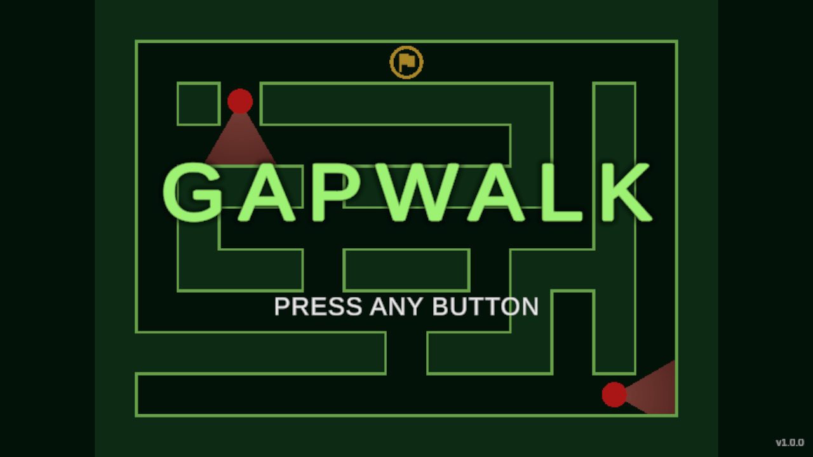
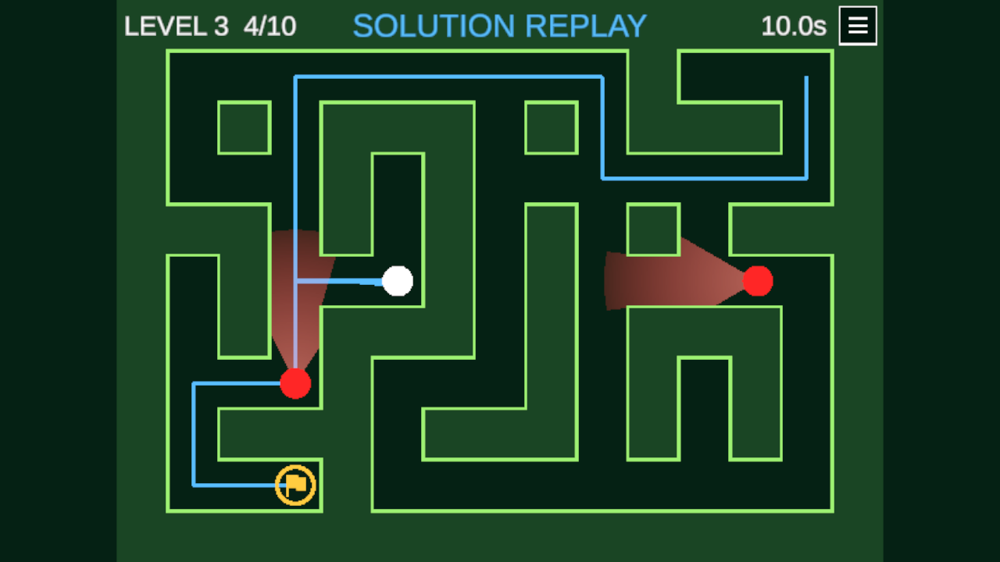

# GAPWALK

A top-down stealth maze game. Every stage is generated automatically and checked by a solver, so every stage is guaranteed to be clearable without being seen.

**Play in your browser:** https://takemal-studio.github.io/gapwalk/

- Controls: WASD / arrow keys, or a gamepad (left stick). Esc / Start opens the menu.
- 500 stages in 50 levels.

This repository contains only the built Web version (Unity WebGL).
Third-party materials and their licenses are listed in [THIRD-PARTY-NOTICES.txt](THIRD-PARTY-NOTICES.txt).

© takemal-studio
